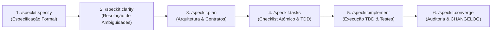

# Protocolo de Governança e Diretrizes para Agentes Autônomos (AGENTES.MD)

> **REGRA DE OURO (MANDATÓRIA):**
> **Toda e qualquer alteração no código de produção, testes, dependências, crates ou arquitetura DEVE OBRIGATORIAMENTE ser precedida por uma especificação formal estruturada via GitHub Spec Kit (`speckit`).**
> É expressamente proibida a edição direta de código ("vibe coding"), modificações ad-hoc ou alterações estruturais sem especificação, plano de implementação e checklist de validação aprovados.

---

## 1. Ciclo de Vida Obrigatório de Desenvolvimento (Spec-Driven Development - SDD)

Todos os agentes de IA (Antigravity, Claude Code, Gemini CLI, Copilot, Codex, etc.) que atuarem no workspace KinePlex devem seguir rigorosamente o pipeline de 6 fases do Spec Kit:



### Fase 1: Especificação Formal (`/speckit.specify`)
- Criar a especificação do recurso utilizando o template oficial em `.specify/templates/spec-template.md` ou o script:
  ```bash
  .specify/scripts/bash/create-new-feature.sh "<descrição_do_recurso>" --short-name "<nome-curto>"
  ```
- O arquivo `specs/<###-nome-recurso>/spec.md` deve conter:
  1. **Objetivo e Contexto Teórico**: Fundamentação matemática e física sem simplificações espúrias.
  2. **User Stories Priorizadas (P1, P2, P3)**: Cada uma com testes independentes e cenários Given/When/Then.
  3. **Requisitos Funcionais (FR-xxx)**: Cláusulas contratuais inequívocas e verificáveis.
  4. **Critérios de Aceitação (AC-xxx) e DoD (Definition of Done)**.
  5. **Casos de Borda e Falhas**: Tratamento de limites extremos, OOM, corrupção e interrupções.

### Fase 2: Clarificação e De-risking (`/speckit.clarify`)
- Identificar e eliminar qualquer ambiguidade de tipos, protocolos de rede, formatos binários (Arrow/Parquet/ZSTD) ou permissões de kernel (eBPF/XDP/CAP_NET_ADMIN).

### Fase 3: Planejamento Arquitetural (`/speckit.plan`)
- Mapear a árvore de crates afetada (`kineplex-core`, `kineplex-df`, `kineplex-net`, `kineplex-node`, `kineplex-sdk`, `kineplex-cli`, `kineplex-server`).
- Projetar structs, traits, layouts de memória cache-aligned (`#[repr(align(64))]`) e orçamentos de CPU/RAM.
- Avaliar o impacto de novas dependências externas no `Cargo.toml`.

### Fase 4: Decomposição em Tarefas Atômicas (`/speckit.tasks`)
- Decompor o trabalho em tarefas atômicas estritamente ordenadas com dependências explícitas.
- Cada tarefa deve conter seu teste unitário ou de integração correspondente antes ou junto à implementação.

### Fase 5: Implementação Guiada (`/speckit.implement`)
- Ciclo TDD estrito: **Red** (teste falha) -> **Green** (código mínimo passa) -> **Refactor** (otimização SIMD/zero-alloc).
- Manter o gate de cobertura de testes do workspace estritamente $\ge 95\%$.
- Respeitar o orçamento de CPU: zero alocações na heap em loops críticos (*hot path*).

### Fase 6: Convergência, Auditoria e Release (`/speckit.converge`)
- Verificar conformidade integral contra a especificação original.
- Atualizar o `CHANGELOG.md` com as entradas padronizadas no formato [Keep a Changelog](https://keepachangelog.com/).
- Atualizar a versão SemVer correspondente no `Cargo.toml` e gerar tag Git correspondente se for uma release.

---

## 2. Invariantes Técnicos e Arquiteturais do KinePlex

1. **Rigor Matemático**: Não substituir equações analíticas ou princípios formais (ex.: Transporte Ótimo de Monge-Kantorovich, Tesselagens de Laguerre, Espaços de Banach, Álgebra de Galois) por heurísticas não formalizadas.
2. **Zero-Copy e Alinhamento de Hardware**:
   - Vetores e buffers colunares Arrow devem privilegiar zero-copy e fatiamento seguro.
   - Estruturas de índice e bitboards devem ser alinhadas à linha de cache L1/L2 (64 bytes).
3. **Isolamento de I/O e Nuvens**:
   - O núcleo computacional (`kineplex-core`, `kineplex-df`) não deve acoplar drivers de nuvem externos diretamente no código de domínio; abstrações via traits (ex.: `ObjectStore` / `LaguerreParquetSink`) devem ser sempre mantidas para viabilizar testes instantâneos em memória.
4. **Governança de Código e CI**:
   - Nenhum commit deve quebrar `cargo check --workspace` ou `cargo test --workspace`.
   - Comentários e documentação técnica devem ser mantidos e expandidos em caso de evolução de código.
