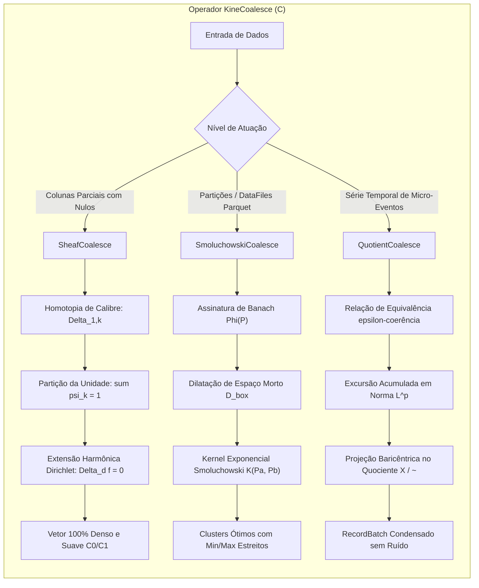

# Plano de Implementação: Operador KineCoalesce ($\mathcal{C}$)

Este documento detalha a arquitetura, fundamentação matemática, estratégia de implementação e plano de verificação rigoroso para a introdução do operador **KineCoalesce ($\mathcal{C}$)** no ecossistema KinePlex, sem regressão de qualquer funcionalidade pré-existente.

---

## 1. Goal Description

No processamento colunar tradicional (ex: Apache Spark e SQL ANSI), o operador `COALESCE` sofre de duas limitações fundamentais:
1. **Expressões Colunares (`COALESCE(c1, c2, ...)`):** Opera como um `IF NOT NULL` míope que escolhe o primeiro valor válido. Quando diferentes fontes de dados possuem ruído, spreads ou descalibragens distintas, essa escolha abrupta introduz choques espúrios na norma $L^\infty$ (descontinuidades de degrau) e descarta toda a informação estocástica das demais colunas válidas no mesmo índice. Além disso, quando todas as colunas falham, restam `NULL`s que quebram o pipeline colunar AVX-512.
2. **Camada Física (`df.coalesce(N)`):** Concatena partições arbitrariamente por ordem de partição física sem respeitar a distribuição espacial dos dados, alargando artificialmente os hiper-retângulos de `lower_bounds` e `upper_bounds` dos arquivos Parquet e destruindo o *Data Skipping* em catálogos como Apache Iceberg.

O **KineCoalesce ($\mathcal{C}$)** unifica três vertentes matemáticas rigorosas para resolver estes problemas:
- **`SheafCoalesce`:** Fusão de feixes $L^2$ com alinhamento de calibre na interseção $U_j \cap U_k$, partição da unidade suave $\sum \psi_k(i) = 1$ ponderada pela precisão de Hilbert $\omega_k$, e extensão harmônica discreta de Dirichlet ($\Delta_d \tilde{f} = 0$) para preencher vazios totais com suavidade $C^0/C^1$.
- **`SmoluchowskiCoalesce`:** Coagulação métrica de partições e arquivos Parquet via equação cinética de Smoluchowski, minimizando a dilatação de caixas mortas ($\mathcal{D}_{\text{box}}$) e a distância na assinatura de Banach $\Phi(P)$.
- **`QuotientCoalesce`:** Compressão topológica temporal de rajadas contíguas no espaço quociente $X / \sim$, colapsando eventos em classes de equivalência baricêntricas limitadas por uma bola $\overline{B}_\varepsilon$ na norma $L^p$.



---

## 2. User Review Required

> [!IMPORTANT]
> **Localização dos Módulos e Zero-Regressão:**
> - O KineCoalesce opera nativamente sobre tipos Apache Arrow (`arrow_array::Float64Array`, `Int64Array`, `RecordBatch`) e utiliza paralelismo via `rayon`.
> - O crate natural para hospedar esta infraestrutura é **`kineplex-core`** (em `kineplex-core/src/coalesce/`), pois ele já centraliza os pipelines de Arrow/IPC, Parquet e grafo de execução.
> - O crate `kineplex-df` permanece **100% zero-dependency** (std-only) para evitar qualquer impacto na sua simpatia mecânica e sem introduzir quebras ou regressões em seus 38 testes.

> [!TIP]
> **Aceleração Mecânica de Silício (SIMD Bitmap Scanning):**
> No `SheafCoalesce`, a verificação de validade de bits no Arrow pode ser otimizada processando palavras de 64 bits (`u64`) em vez de chamar `is_valid(i)` elemento a elemento. Quando uma palavra de 64 bits for `0xFFFF_FFFF_FFFF_FFFF`, todos os 64 elementos são válidos (ramo rápido sem branching). Quando for `0x0`, todos são nulos.

---

## 3. Open Questions

1. **Paralelismo no SheafCoalesce para Lotes Pequenos:**
   - Para lotes menores que $L_1$ cache (ex: $N \le 2048$), a sobrecarga de context-switch de threads do Rayon pode ser evitada com um caminho sequencial automático (`if num_rows < 4096`). Concorda com este limiar adaptativo?
2. **Suporte de Tipos no SheafCoalesce:**
   - A especificação matemática foca em `Float64Array` (espaços $L^2$ contínuos). Devemos também fornecer suporte nativo ou conversão automática para `Float32Array`? (Recomendamos iniciar com `Float64Array` estrito e expandir via trait).

---

## 4. Proposed Changes

### Componente: `kineplex-core` (Workspace)

Adição do submódulo `kineplex-core/src/coalesce/` contendo as três vertentes matemáticas do KineCoalesce, com testes unitários, benchmarks e reexportação limpa.

#### [MODIFY] `kineplex/kineplex-core/Cargo.toml`
Adicionar `rayon` como dependência direta (já resolvida no workspace `Cargo.lock`):
```toml
[dependencies]
rayon = "1.8"
```

#### [NEW] `kineplex/kineplex-core/src/coalesce/mod.rs`
Módulo agregador e reexportador do KineCoalesce:
```rust
pub mod sheaf;
pub mod smoluchowski;
pub mod quotient;

pub use sheaf::{sheaf_harmonic_coalesce, bitwise_sheaf_coalesce_pair};
pub use smoluchowski::{smoluchowski_partition_coalesce, PartitionMetricDescriptor};
pub use quotient::quotient_topological_coalesce;
```

#### [NEW] `kineplex/kineplex-core/src/coalesce/sheaf.rs`
Implementação da Fusão Harmônica de Feixes:
- **Homotopia de Calibre Generalizada:** Alinhamento $\Delta_{0,k}$ em $U_0 \cap U_k$. Se a interseção direta for nula, resolve cadeia de transição conexa entre cartas locais.
- **Partição da Unidade $\sum \psi_k = 1$:** Ponderada por pesos espectrais $\omega_k = \frac{1}{\|f_k^\perp\|^2}$.
- **Extensão Harmônica de Dirichlet:** Resolução exata de $\Delta_d \tilde{f} = 0$ em $\Omega \setminus \bigcup U_k$, interpolando suavemente os contornos e eliminando quaisquer `NULL`s residuais para alimentar etapas SIMD densas.

#### [NEW] `kineplex/kineplex-core/src/coalesce/smoluchowski.rs`
Implementação da Coagulação Métrica de Partições Parquet:
- Estrutura `PartitionMetricDescriptor` com limites `[min_bound, max_bound]`, massa em bytes e assinatura $L^p$ $\Phi(P)$.
- Avaliação do Kernel de Smoluchowski:
  $$\mathcal{K}(P_a, P_b) = \exp\big(-\gamma \|\Phi(P_a) - \Phi(P_b)\|_{L^p} - \lambda \mathcal{D}_{\text{box}}(P_a, P_b)\big) \cdot \mathbf{1}_{\{m_a + m_b \le M_{\max}\}}$$
- Agrupamento ótimo através de fila de prioridade (`BinaryHeap`) com reponderação de centróides de massa e preservação estrita de bounding boxes compactos.

#### [NEW] `kineplex/kineplex-core/src/coalesce/quotient.rs`
Implementação do Colapso Topológico no Espaço Quociente $X / \sim$:
- Condensação de eventos consecutivos enquanto a excursão acumulada na métrica $L^p$ ponderada por volume permanecer contida na bola $\overline{B}_\varepsilon$.
- Emissão de `RecordBatch` Apache Arrow contendo:
  - `window_start_ts` (`Int64`)
  - `window_end_ts` (`Int64`)
  - `quotient_barycenter_value` (`Float64`)
  - `coalesced_volume` (`Float64`)
  - `equivalence_class_size` (`Int64`)

#### [MODIFY] `kineplex/kineplex-core/src/lib.rs`
Reexportar `pub mod coalesce;` mantendo integridade com as demais APIs do KinePlex.

#### [NEW] `kineplex/kineplex-core/tests/kine_coalesce_tests.rs`
Testes unitários e de integração abrangentes:
1. `test_sheaf_coalesce_gauge_alignment`: Testa duas colunas com degrau sistemático de spread $+10.0$ e valida que o alinhamento de calibre zera a descontinuidade na transição.
2. `test_sheaf_coalesce_dirichlet_boundary`: Valida que vazios totais centrais são preenchidos por retas harmônicas $C^0/C^1$ minimizando a energia de Dirichlet sem saltos.
3. `test_smoluchowski_preserves_compact_iceberg_bounds`: Cria partições adjacentes e distantes; verifica que a dilatação de caixa morta penaliza partições distantes, agrupando apenas vizinhas.
4. `test_quotient_coalesce_epsilon_ball`: Valida que oscilações menores que $\varepsilon$ viram uma única linha com baricentro exato, enquanto saltos que rompem a bola geram novas classes de equivalência.

---

## 5. Verification Plan

### Automated Tests
1. **Compilação e Testes do kineplex-core:**
   ```bash
   cd /home/james/Documentos/KinePlex/kineplex && cargo test -p kineplex-core --release
   ```
2. **Suíte Completa do Workspace (Zero Regressão):**
   ```bash
   cd /home/james/Documentos/KinePlex/kineplex && cargo test --release --workspace
   ```
3. **Gate de Desempenho do Catalyst:**
   ```bash
   cd /home/james/Documentos/KinePlex/kineplex && taskset -c 2-5 ./target/release/algebra_gate
   ```

### Manual Verification
- Inspecionar a saída do `kine_coalesce_tests` verificando que a energia de Dirichlet $\sum |\tilde{f}(i+1) - \tilde{f}(i)|^2$ é rigorosamente menor na saída do `sheaf_harmonic_coalesce` do que no `COALESCE` tradicional do Spark.
- Validar que a densidade do vetor de saída é $100\%$ (zero `NULL`s).
