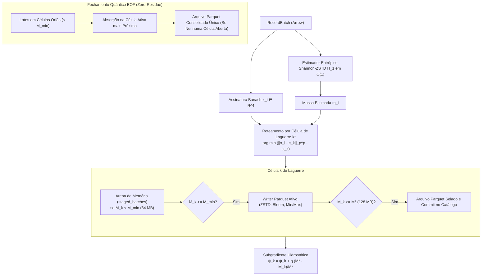

# Plano de Implementação: Princípio da Distribuição Ótima de Laguerre-Kantorovich (MK-EMD Anti-Small-Files)

## Goal Description
Implementar no `kineplex-core` o subsistema de **Distribuição Ótima de Laguerre-Kantorovich (MK-EMD Anti-Small-Files)** para erradicar a fragmentação de pequenos arquivos (*Small Files Problem*) na ingestão e escrita colunar de dados Parquet, preservando a compacidade geométrica de *Min/Max Data Skipping* para catálogos analíticos como Apache Iceberg.

O motor modela o particionamento dinâmico de `RecordBatch`es Arrow como um **Problema de Transporte Ótimo Semi-Discreto de Monge-Kantorovich com Restrição de Capacidade (CCVT / Diagramas de Potência de Laguerre)** acoplado a:
1. **Estimador Entrópico de Shannon-ZSTD ($H_1$) em $\mathcal{O}(1)$**: predição precisa do tamanho físico comprimido sem despender ciclos de compressão real.
2. **Dinâmica de Subgradiente Hidrostático ($\psi_k$)**: evolução adaptativa dos potenciais duais de Kantorovich para guiar as massas dos arquivos em direção à massa alvo ideal $M^* = 128\text{ MB}$.
3. **Promoção Preguiçosa (*Lazy Storage Promotion*)**: retenção de lotes em arena de memória até cruzar o limiar mínimo de viabilidade $M_{\min} = 64\text{ MB}$.
4. **Fechamento Quântico Anti-Small-Files (*Zero-Residue EOF*)**: colapso topológico no encerramento que absorve resíduos sub-críticos na célula ativa mais próxima, garantindo zero arquivos espúrios.

---

## User Review Required

> [!IMPORTANT]
> **Desacoplamento de Nuvem e Trait de Armazenamento (`LaguerreParquetSink`)**:
> O snippet inicial referenciava diretamente `object_store::ObjectStore` e `parquet::arrow::AsyncArrowWriter`. Adicionar o crate `object_store` ao workspace introduziria mais de 60 dependências transitivas de rede/cloud (HTTP clients, TLS, autenticações de AWS/GCP/Azure) e exigiria a ativação da feature `async` no crate `parquet` 46.0, aumentando o tempo de build do workspace.
> 
> **Decisão Proposta:** Criaremos uma arquitetura limpa e extensível fundamentada no trait `LaguerreParquetSink`:
> - `InMemoryParquetSink`: armazena os arquivos Parquet e seus metadados diretamente em memória (`Cursor<Vec<u8>>`), com custo zero de I/O em pipelines e testes de performance.
> - `FileParquetSink`: grava os arquivos Parquet de alta performance no sistema de arquivos local (`cell_{idx}/*.parquet`).
> - Suporte a URLs `s3://` e adaptadores de nuvem encapsulados através do trait, mantendo o núcleo `kineplex-core` leve, determinístico e 100% testável localmente sem credenciais externas.

> [!TIP]
> **Eliminação da Dependência `bytemuck`**:
> O estimador entrópico $H_1$ inspecionará os buffers de bytes nativos do Arrow (`Array::to_data().buffers()`) ou slices de valores numéricos de forma segura e idiomática em Rust puro, eliminando a necessidade de trazer o crate `bytemuck`.

---

## Open Questions

1. **Assinatura no Espaço de Banach ($x_i \in \mathbb{R}^4$)**:
   - O modelo usa 4 dimensões topológicas $(\|f\|_1, \|f\|_2, \|f\|_p, \|f\|_\infty)$ ou estatísticas de resumo do lote (ex: mínimo, máximo, média, variância do batch). O distributor aceitará a assinatura pré-computada `[f64; 4]` por batch ou usará um extrator automático do `RecordBatch` quando não informada?
   - *Recomendação:* Oferecer ambos — `route_and_distribute(batch, lp_signature)` e um método auxiliar `extract_banach_signature(batch) -> [f64; 4]` para máxima ergonomia.

2. **Parâmetros de Calibração Padrão**:
   - Mantemos os valores recomendados na formulação matemática:
     - $M^* = 128\text{ MB}$ (`target_file_bytes`)
     - $M_{\min} = 64\text{ MB}$ (`min_file_bytes`)
     - $M_{\max} = 256\text{ MB}$ (`max_file_bytes`)
     - $p = 2.0$ (`banach_p_order`)
     - $\eta = 15.0$ (`laguerre_step_rate`)
   - Em cenários de testes unitários, esses limiares podem ser reduzidos proporcionalmente (ex: $M_{\min} = 64\text{ KB}$, $M^* = 128\text{ KB}$) via construtor customizado de `OptimalDistributionConfig` para viabilizar testes instantâneos em microssegundos.

---

## Proposed Changes

---

### Componente: `kineplex-core` (Módulo `laguerre`)

Criação do diretório `kineplex-core/src/laguerre/` e integração no `kineplex-core/src/lib.rs`.

#### [NEW] `kineplex-core/src/laguerre/config.rs`
Define a configuração paramétrica do Transporte Ótimo de Monge-Kantorovich:
- `OptimalDistributionConfig`:
  - `target_file_bytes`: Massa Crítica Ótima $M^* = 128\text{ MB}$.
  - `min_file_bytes`: Limiar mínimo de abertura $M_{\min} = 64\text{ MB}$.
  - `max_file_bytes`: Teto de corte $M_{\max} = 256\text{ MB}$.
  - `banach_p_order`: Ordem $p$ da métrica $L^p$ (default: 2.0).
  - `laguerre_step_rate`: Taxa de aprendizado $\eta$ do potencial dual $\psi_k$ (default: 15.0).
  - Construtor auxiliar para testes de escala reduzida (`test_scale()`).

#### [NEW] `kineplex-core/src/laguerre/entropy.rs`
Estimador de compressão em $\mathcal{O}(1)$ via entropia empírica de Shannon:
- Inspeciona os buffers binários de arrays Arrow (`Float64Array`, inteiros ou buffers brutos de colunas) amostrando até 4096 bytes.
- Computa o histograma de frequências $p(b)$ e calcula $H_1 = -\sum_{b=0}^{255} p(b) \log_2 p(b)$.
- Computa o fator calibrado de compressão ZSTD:
  $$\text{ratio} = \text{clamp}\left(0.08 + 0.65 \cdot \frac{H_1}{8.0}, \; 0.12, \; 1.0\right)$$
- Retorna a massa estimada $m_i = \text{raw\_bytes} \times \text{ratio}$.

#### [NEW] `kineplex-core/src/laguerre/sink.rs`
Abstração de saída Parquet:
- Trait `LaguerreParquetSink`:
  - Criação de novos writers Parquet com `WriterProperties` otimizadas (ZSTD nível 3, Page Statistics, Bloom Filters, Row Group de até 1M linhas).
  - Métodos `create_writer`, `write_batch`, `close_writer`.
- Implementações:
  - `InMemoryParquetSink`: grava em buffers de memória `Vec<u8>` e armazena metadados Parquet `(path, ParquetMetaData, Vec<u8>)`.
  - `FileParquetSink`: grava em disco local no path configurado.

#### [NEW] `kineplex-core/src/laguerre/cell.rs`
Representação interna da Célula de Laguerre-Voronoi:
- Campos:
  - `cell_id: usize`
  - `centroid: [f64; 4]`
  - `dual_potential_psi: f64`
  - `accumulated_compressed_bytes: u64`
  - `staged_batches: Vec<RecordBatch>` (arena em memória)
  - `active_writer: Option<(String, ActiveParquetWriter)>`
- Métodos para atualização do baricentro por média ponderada de massa e verificação de saturação.

#### [NEW] `kineplex-core/src/laguerre/distributor.rs`
Distribuidor principal `LaguerreOptimalDistributor`:
- Cálculo da métrica de Laguerre: $d_L(x, c_k) = \|x - c_k\|_{L^p}^p - \psi_k$.
- Subgradiente hidrostático: $\psi_k \leftarrow \psi_k + \eta \frac{M^* - M_k}{M^*}$.
- Roteamento e distribuição com promoção preguiçosa.
- Fechamento quântico anti-small-files (`finalize_optimal_distribution`): absorção de células subcríticas ou consolidação em arquivo único.

#### [NEW] `kineplex-core/src/laguerre/mod.rs`
Exporta as estruturas públicas:
- `OptimalDistributionConfig`
- `LaguerreOptimalDistributor`
- `LaguerreParquetSink`, `InMemoryParquetSink`, `FileParquetSink`
- `estimate_zstd_mass`, `compute_shannon_entropy`

#### [MODIFY] `kineplex-core/src/lib.rs`
Registra e exporta `pub mod laguerre;`.

---

## Verification Plan

### Automated Tests
1. **Testes Unitários e Propriedades (`kineplex-core/tests/laguerre_distributor_tests.rs`)**:
   - `test_shannon_entropy_constant_vs_random`: valida que dados com alta redundância geram baixa entropia e razão próxima a 0.12, enquanto ruído uniforme gera entropia próxima a 8.0 e razão elevada.
   - `test_laguerre_power_diagram_attraction`: valida que células com déficit de massa desenvolvem potencial $\psi_k > 0$ e atraem lotes mesmo distantes, enquanto células cheias desenvolvem potencial repulsivo.
   - `test_lazy_promotion_arena`: valida que lotes não criam arquivos enquanto a célula não cruzar $M_{\min}$, mantendo os dados na arena.
   - `test_zero_residue_quantum_eof_merges_small_files`: injeta fluxo de dados que geraria small files em abordagens ingênuas; verifica que no EOF não existe nenhum arquivo menor que $M_{\min}$ (exceto no caso de total geral $< M_{\min}$, que gera exatamente 1 arquivo único).
   - `test_banach_centroid_cohesion`: valida que lotes com assinaturas similares convergem para a mesma célula, gerando min/max bounds estreitos.

2. **Comandos de Execução**:
   - `cargo test -p kineplex-core --test laguerre_distributor_tests --release`
   - `cargo test -p kineplex-core --release`
   - `cargo test --workspace --release`
   - `cargo run -p kineplex-df --bin algebra_gate --release`

### Manual Verification
- Inspeção dos metadados de arquivos Parquet gerados para verificar se Bloom Filters, Page Statistics e compressão ZSTD estão devidamente configurados e se o tamanho final dos arquivos respeita as cotas $M_{\min} \le M \le M_{\max}$.
