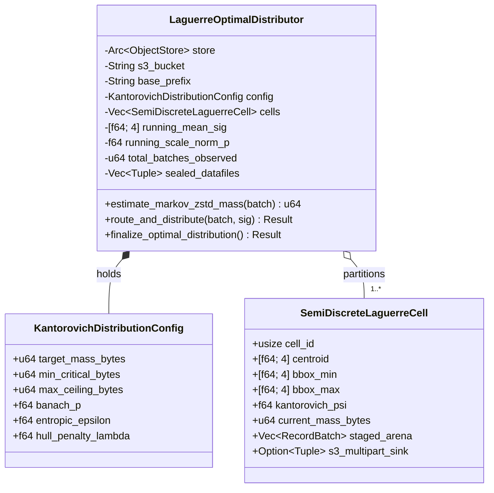

# Data Model: Distribuidor de Laguerre-Kantorovich (MK-EMD)

**Feature**: `001-laguerre-kantorovich-fixes` (FT-097)  
**Date**: 2026-11-10  
**Status**: Completed  

---

## 1. Diagrama de Entidades e Relacionamentos

---

## 2. Definição Detalhada das Estruturas e Campos

### 2.1 `KantorovichDistributionConfig`
Representa os parâmetros termodinâmicos e os limiares físicos do transporte ótimo:
- `target_mass_bytes: u64` ($M^* = 128\text{ MB}$): Massa alvo ótima por arquivo Parquet.
- `min_critical_bytes: u64` ($M_{\min} = 64\text{ MB}$): Limite mínimo para descarregar a memória e inicializar o upload multipart no S3.
- `max_ceiling_bytes: u64` ($M_{\max} = 256\text{ MB}$): Limite máximo absoluto de tamanho de arquivo aceito na coalescência.
- `banach_p: f64` ($p = 2.0$): Ordem da norma $L^p$ no espaço métrico de Banach para cálculo das distâncias geodésicas.
- `entropic_epsilon: f64` ($\varepsilon = 0.25$): Fator de amortecimento de regularização entrópica no passo Log-Sinkhorn.
- `hull_penalty_lambda: f64` ($\lambda_{\text{hull}} = 0.50$): Coeficiente de penalidade contra dilatação da bounding box min/max do Iceberg.

### 2.2 `SemiDiscreteLaguerreCell`
Célula de Voronoi generalizada ponderada com rastreamento geométrico:
- `cell_id: usize`: Identificador único da partição na tesselação.
- `centroid: [f64; 4]`: Baricentro atualizado continuamente no espaço de Banach $\mathbb{R}^4$.
- `bbox_min: [f64; 4]`: Vetor de mínimos para cada uma das 4 dimensões topológicas.
- `bbox_max: [f64; 4]`: Vetor de máximos para cada uma das 4 dimensões topológicas.
- `kantorovich_psi: f64`: Potencial dual $\psi_k$ sujeito ao invariante $\sum_{k=1}^K \psi_k = 0$.
- `current_mass_bytes: u64`: Soma estimada das massas dos lotes contidos na célula.
- `staged_arena: Vec<RecordBatch>`: Buffer em memória RAM para lotes enquanto $M_k < M_{\min}$.
- `s3_multipart_sink: Option<(String, AsyncArrowWriter<BufWriter>)>`: Parquet writer ativo apontando para o S3/ObjectStore assim que $M_k \ge M_{\min}$.

### 2.3 `LaguerreOptimalDistributor`
O motor central de orquestração do particionamento:
- `store: Arc<dyn ObjectStore>`: Trait object de acesso unificado ao sistema de arquivos/nuvem.
- `s3_bucket: String`: Nome do bucket de destino.
- `base_prefix: String`: Prefixo base para os arquivos gerados.
- `running_mean_sig: [f64; 4]`: Média acumulada online das assinaturas calculada via Welford.
- `running_scale_norm_p: f64`: Fator de adimensionalização $\sigma_X^p$ na norma $L^p$ ($\ge 10^{-6}$).
- `total_batches_observed: u64`: Contador de lotes processados para calibração estatística.
- `sealed_datafiles: Vec<(String, ParquetMetaData)>`: Registro imutável de URIs e metadados de arquivos selados.

---

## 3. Invariantes de Estado e Transições

1. **Invariante de Soma Zero do Potencial Dual**:
   $$\sum_{k=1}^K \psi_k = 0 \quad (\pm 10^{-12})$$
2. **Invariante de Promoção Preguiçosa**:
   $$\text{s3\_multipart\_sink.is\_some()} \iff M_k \ge M_{\min}$$
3. **Invariante Anti-Small-Files**:
   $$\forall (uri, meta) \in \text{sealed\_datafiles}, \quad \text{size}(uri) \ge M_{\min} \lor |\text{sealed\_datafiles}| = 1$$
4. **Invariante de Teto de Coalescência**:
   $$M_{\text{final}} \le M_{\max} = 256\text{ MB}$$
