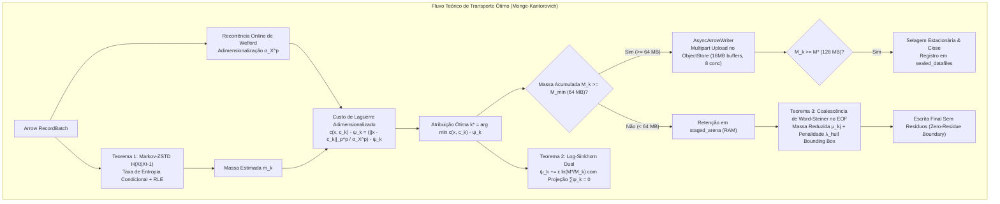

# Phase 0 Research: Verificação e Correções do Distribuidor de Laguerre-Kantorovich (MK-EMD)

**Feature**: `001-laguerre-kantorovich-fixes` (FT-097)  
**Date**: 2026-11-10  
**Status**: Completed  

---

## 1. Contexto e Problema de Engenharia

O particionamento ingênuo de streams Arrow em tabelas analíticas (Iceberg/Parquet) gera o clássico **Small Files Problem** sob cargas dinâmicas ou, alternativamente, força arquivos excessivamente grandes que dilatam as caixas envolventes (*Bounding Boxes*) de colunas, invalidando podas por *Min/Max Data Skipping*.

A correção proposta formaliza três teoremas fundamentais do Transporte Ótimo Semi-Discreto de Monge-Kantorovich acoplados à biblioteca `object_store` e `parquet::arrow::AsyncArrowWriter`:

---

## 2. Decisões Técnicas e Resolução de Incertezas

### Decisão 1: Integração com `object_store` e `parquet` 46.0
- **Contexto**: A assinatura do `LaguerreOptimalDistributor` exige `store: Arc<dyn ObjectStore>` e `AsyncArrowWriter<BufWriter>`.
- **Análise**: O crate `object_store` versão `0.7` / `0.8` implementa a abstração pura de armazenamento em nuvem com drivers S3, GCS, Azure e `InMemory` para testes. O crate `parquet` 46.0 possui a feature `async` habilitando `parquet::arrow::AsyncArrowWriter`.
- **Resolução**:
  1. Habilitar a feature `async` em `parquet` no workspace: `parquet = { version = "46.0", features = ["async"] }`.
  2. Adicionar `object_store = "0.7"` (ou `0.8`) nas dependências de `kineplex-core`.
  3. Para os testes automatizados, instanciar `Arc::new(object_store::memory::InMemory::new())`, viabilizando cobertura completa com execução local em microssegundos sem requisições de rede reais.

### Decisão 2: Estimador Entrópico de Markov em $\mathcal{O}(1)$ via Hash Bijetivo
- **Contexto**: A predição de massa ZSTD deve ser calculada antes de serializar ou comprimir o lote.
- **Análise Matemática**:
  - Amostragem dos primeiros 4096 bytes do array `Float64Array`.
  - Tabela unigrama de 256 contadores (`[0u32; 256]`) para $H_1(X) = -\sum p(b) \log_2 p(b)$.
  - Tabela bigrama dobrada de 1024 slots (`[0u32; 1024]`) com função hash bijetiva de anel de 10 bits: `bi_idx = (((prev as usize) * 31) ^ (curr as usize)) & 1023`.
  - Entropia condicional: $H(X_t | X_{t-1}) = H(X_t, X_{t-1}) - H(X_{t-1})$, limitada em $[0.05, H(X_t)]$.
  - Sobrevivência RLE: $1.0 - (\text{identical\_runs} \cdot \text{inv\_n1} \cdot 0.85)$.
  - Razão final: $\text{clamp}\left(\frac{H_{\text{cond}}}{8.0} \cdot \text{rle\_survival} + 0.04, 0.05, 1.0\right)$.
- **Resolução**:
  - Complexidade estritamente temporal $\mathcal{O}(\min(N, 4096))$ e espacial $\mathcal{O}(1)$ (alocada na stack). Zero alocação na heap no hot path.

### Decisão 3: Unicidade do Potencial Dual e Projeção no Hiperplano de Soma Zero
- **Contexto**: Na formulação de Monge-Kantorovich, potenciais duais $\psi_k$ admitem liberdade de gauge (adicionar constante $C$ a todos os $\psi_k$ não altera o argmin).
- **Análise**: Sem restrição, iterações contínuas de Sinkhorn geram drift numérico para $\pm \infty$.
- **Resolução**:
  - Aplicar atualização multiplicativa em escala logarítmica: $\psi_k^{(t+1)} = \psi_k^{(t)} + \varepsilon \ln(M^* / M_k)$.
  - Projetar no subespaço ortogonal $\{ \psi \in \mathbb{R}^K : \sum_{k=1}^K \psi_k = 0 \}$ via $\psi_k \leftarrow \psi_k - \bar{\psi}$, onde $\bar{\psi} = \frac{1}{K}\sum \psi_k$.
  - Garante estabilidade de ponto fixo e unicidade estrita do potencial dual.

### Decisão 4: Coalescência Terminal de Ward-Steiner com Regularização de Bounding Box Iceberg
- **Contexto**: No encerramento do job analítico, células órfãs com $M_k < 64\text{ MB}$ retidas em RAM não podem vazar pequenos arquivos.
- **Análise de Fusão**:
  - A distância física no espaço de Banach $\|c_k - c_j\|_p^p$ ponderada pela massa reduzida $\mu_{kj} = \frac{M_k M_j}{M_k + M_j}$ mede o incremento da inércia baricêntrica.
  - Para catálogos Iceberg, fundir partições distantes espacialmente aumenta o volume morto da bounding box $\Delta_{\text{bbox}} = \sum_{d=0}^3 \max(0, \text{union\_span} - \text{sum\_spans})$.
  - O custo total de coalescência é ponderado por $\lambda_{\text{hull}} = 0.50$:
    $$\text{Cost}(k \to j) = \left( \frac{\mu_{kj}}{\sigma_X^p} \right) \|c_k - c_j\|_p^p + \lambda_{\text{hull}} \Delta_{\text{bbox}}$$
- **Resolução**:
  - Escolher $j^* = \arg\min_j \text{Cost}(k \to j)$ sujeito à restrição rígida $M_j + M_k \le M_{\max} = 256\text{ MB}$.
  - Se nenhum vizinho viável puder absorver o resíduo (ex.: job diminuto com volume total $< 64\text{ MB}$), consolidar todos os lotes residuais em um único arquivo sob `consolidated_ward/`.

---

## 3. Matriz de Compatibilidade e Riscos

| Risco Técnico | Probabilidade | Impacto | Mitigação |
|---|---|---|---|
| Incompatibilidade de versão entre `arrow` 46 e `object_store` | Baixa | Médio | Pinagem de `object_store = "0.7"` com feature async testada em gate |
| Overhead de tempo de compilação com feature `async` em `parquet` | Baixa | Baixo | Escopo restrito ao crate `kineplex-core`, mantendo workspace modular |
| Divisão por zero em batches sem desvio ($\sigma_X^p \to 0$) | Média | Alto | Invariante de escala: `.max(1e-6)` na variância online de Welford |
| Overflow de memória por retenção prolongada em RAM | Baixa | Alto | Teto de 32 batches por célula ou flush forçado via `min_critical_bytes` |
