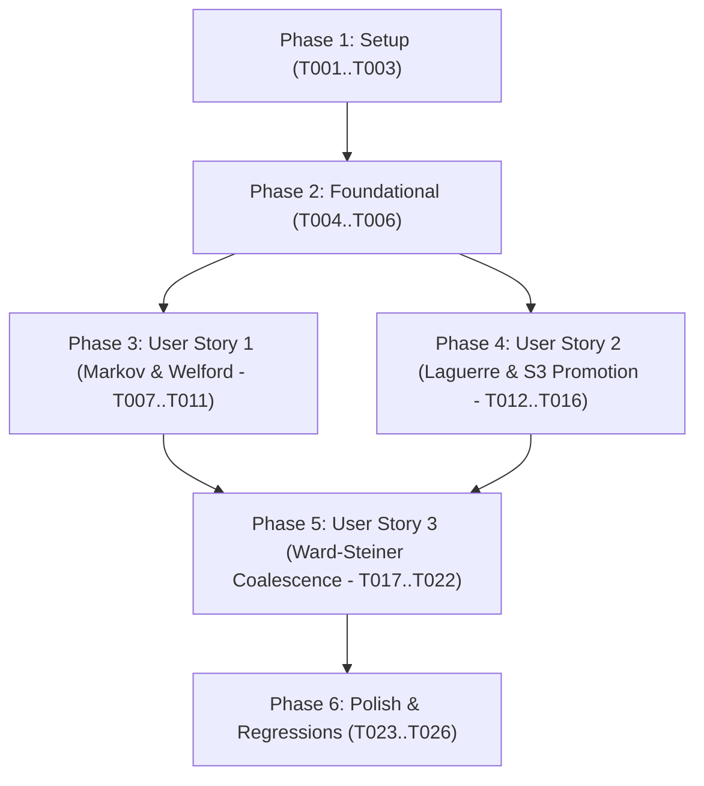

# Tasks: Verificação e Aplicação das Correções do Distribuidor de Laguerre-Kantorovich (MK-EMD)

**Input**: Design documents from `/specs/001-laguerre-kantorovich-fixes/` (`plan.md`, `spec.md`, `research.md`, `data-model.md`, `contracts/distributor_api.md`, `quickstart.md`)  
**Prerequisites**: `plan.md`, `spec.md`, `research.md`, `data-model.md`, `contracts/`, `constitution.md`  
**Target Crates**: `kineplex-core`, `kineplex-df`  
**Branch**: `001-laguerre-kantorovich-fixes`  

---

## Phase 1: Setup (Shared Infrastructure & Dependencies)

**Purpose**: Configuração de crates e dependências no workspace para suportar `object_store` e operações assíncronas do Parquet.

- [x] T001 Habilitar `parquet = { version = "46.0", features = ["async"] }` e adicionar dependência `object_store = "0.7"` no workspace em `kineplex/Cargo.toml` e `kineplex/kineplex-core/Cargo.toml`
- [x] T002 [P] Adicionar dependência `bytemuck = "1.14"` em `kineplex/kineplex-core/Cargo.toml`
- [x] T003 [P] Atualizar exportações do módulo `kineplex-core/src/laguerre/mod.rs` e registrar no `kineplex-core/src/lib.rs`

---

## Phase 2: Foundational (Blocking Prerequisites)

**Purpose**: Definição das estruturas básicas, hiperparâmetros de Monge-Kantorovich e célula de Laguerre.

**⚠️ CRITICAL**: Nenhuma tarefa de user story pode ser executada antes da conclusão desta fase.

- [x] T004 Implementar struct `KantorovichDistributionConfig` com valores padrão ($M^* = 128\text{ MB}$, $M_{\min} = 64\text{ MB}$, $M_{\max} = 256\text{ MB}$, $p = 2.0$, $\varepsilon = 0.25$, $\lambda_{\text{hull}} = 0.50$) em `kineplex/kineplex-core/src/laguerre/config.rs`
- [x] T005 [P] Implementar struct `SemiDiscreteLaguerreCell` com baricentro em $\mathbb{R}^4$, bounding box, potencial dual $\psi_k$, `staged_arena: Vec<RecordBatch>` e `s3_multipart_sink: Option<(String, AsyncArrowWriter<BufWriter>)>` em `kineplex/kineplex-core/src/laguerre/cell.rs`
- [x] T006 [P] Implementar helper `parquet_writer_props` configurando Parquet 2.0, compressão ZSTD level 3, Page Statistics, tamanho máximo de row group de 1.048.576 e Bloom Filters em `kineplex/kineplex-core/src/laguerre/distributor.rs`

**Checkpoint**: Estruturas fundamentais compilando limpas no `kineplex-core`.

---

## Phase 3: User Story 1 - Predição Entrópica de Markov em $\mathcal{O}(1)$ e Adimensionalização de Welford (Priority: P1) 🎯 MVP

**Goal**: Predizer em $\mathcal{O}(1)$ de memória a massa ZSTD final de lotes Arrow e calcular a escala invariante $\sigma_X^p$ da variedade via Welford online.

**Independent Test**: Executar `estimate_markov_zstd_mass` sobre amostras RLE (razão $\approx 0.05$), amostras aleatórias gaussianas (razão $\approx 1.0$) e arrays vazios; validar $\sigma_X^p \ge 10^{-6}$ com Welford.

### Tests for User Story 1 ⚠️
> **NOTA: Executar estes testes primeiro e garantir que falhem antes da implementação completa dos métodos.**

- [x] T007 [P] [US1] Criar teste unitário para `estimate_markov_zstd_mass` validando razão de compressão RLE, ruído de alta entropia e fallback de tamanho em `kineplex/kineplex-core/tests/laguerre_distributor_tests.rs`
- [x] T008 [P] [US1] Criar teste unitário para `update_manifold_scale` verificando convergência da escala de Welford sem overflow e piso de $10^{-6}$ em `kineplex/kineplex-core/tests/laguerre_distributor_tests.rs`

### Implementation for User Story 1

- [x] T009 [US1] Implementar `estimate_markov_zstd_mass(batch: &RecordBatch) -> u64` com amostragem de até 4096 bytes de `Float64Array`, unigrama de 256 bins, tabela hash bijetiva de bigramas de 1024 slots (`(((prev * 31) ^ curr) & 1023)`) e taxa condicional $H(X_t | X_{t-1})$ em `kineplex/kineplex-core/src/laguerre/entropy.rs`
- [x] T010 [US1] Implementar `update_manifold_scale(&mut self, sig: &[f64; 4])` atualizando online a média e o desvio da norma $L^p$ via recorrência de Welford com amortecimento exponencial 0.95/0.05 em `kineplex/kineplex-core/src/laguerre/distributor.rs`
- [x] T011 [US1] Validar que o estimador de Markov aloca estritamente na pilha (`[0u32; 256]` e `[0u32; 1024]`), sem alocações na heap no hot path

**Checkpoint**: User Story 1 funcional e testada independentemente com 100% de sucesso.

---

## Phase 4: User Story 2 - Roteamento Adimensionalizado, Log-Sinkhorn e Lazy S3 Promotion (Priority: P1)

**Goal**: Distribuir lotes pela célula ótima de Laguerre, regularizar potenciais no hiperplano de soma zero $\sum \psi_k = 0$, reter em memória enquanto $M_k < 64\text{ MB}$, promover para S3 ao atingir $64\text{ MB}$ e selar ao atingir $128\text{ MB}$.

**Independent Test**: Enviar batches sucessivos contra mock `object_store::memory::InMemory` validando retenção em RAM, transição para `AsyncArrowWriter` e selagem em $128\text{ MB}$.

### Tests for User Story 2 ⚠️

- [x] T012 [P] [US2] Criar teste de integração para `dimensionless_laguerre_cost` e `update_sinkhorn_kantorovich_potentials` validando a invariante $\left|\sum_{k=1}^K \psi_k\right| \le 10^{-12}$ em `kineplex/kineplex-core/tests/laguerre_distributor_tests.rs`
- [x] T013 [P] [US2] Criar teste de integração para promoção preguiçosa (retenção em RAM $< 64\text{ MB}$ e descarregamento assíncrono $\ge 64\text{ MB}$) e selagem aos $128\text{ MB}$ em `kineplex/kineplex-core/tests/laguerre_distributor_tests.rs`

### Implementation for User Story 2

- [x] T014 [US2] Implementar `dimensionless_laguerre_cost(&self, sig: &[f64; 4], cell: &SemiDiscreteLaguerreCell) -> f64` calculando $(\|x - c_k\|_p^p / \sigma_X^p) - \psi_k$ em `kineplex/kineplex-core/src/laguerre/distributor.rs`
- [x] T015 [US2] Implementar `update_sinkhorn_kantorovich_potentials(&mut self)` com passo multiplicativo logarítmico $\psi_k \leftarrow \psi_k + \varepsilon \ln(M^* / M_k)$ e projeção ortogonal centrada em zero em `kineplex/kineplex-core/src/laguerre/distributor.rs`
- [x] T016 [US2] Implementar `route_and_distribute(&mut self, batch: RecordBatch, lp_signature: [f64; 4])` com atribuição ótima, atualização baricêntrica, expansão de Bounding Box, Lazy Promotion com `BufWriter` (16 MB / 8 concorrências) e selagem em `kineplex/kineplex-core/src/laguerre/distributor.rs`

**Checkpoint**: User Stories 1 e 2 funcionais e integradas.

---

## Phase 5: User Story 3 - Coalescência Terminal de Ward-Steiner e Fechamento Zero-Resíduo (Priority: P2)

**Goal**: No encerramento do job analítico, colapsar células órfãs residuais na célula super-crítica que minimiza a inércia reduzida de Ward-Steiner e a dilatação de Bounding Box Iceberg, ou consolidar em arquivo único para jobs com volume $< 64\text{ MB}$.

**Independent Test**: Processar streams gerando células órfãs com massas sub-críticas variadas e verificar que `finalize_optimal_distribution` encerra sem resíduos e com zero pequenos arquivos.

### Tests for User Story 3 ⚠️

- [x] T017 [P] [US3] Criar teste para absorção de células órfãs por vizinhos super-críticos considerando distância e dilatação de bounding box ($\lambda_{\text{hull}}$) em `kineplex/kineplex-core/tests/laguerre_distributor_tests.rs`
- [x] T018 [P] [US3] Criar teste para consolidação de job diminuto ($< 64\text{ MB}$ total) em `consolidated_ward/kinehaus-coalesced-{uuid}.parquet` em `kineplex/kineplex-core/tests/laguerre_distributor_tests.rs`

### Implementation for User Story 3

- [x] T019 [US3] Implementar partição de células órfãs (`s3_multipart_sink.is_none() && !staged_arena.is_empty()`) vs células ativas em `kineplex/kineplex-core/src/laguerre/distributor.rs`
- [x] T020 [US3] Implementar cálculo de custo geodésico de Ward-Steiner com massa reduzida $\mu_{kj}$, dilatação de Bounding Box $\Delta_{\text{bbox}}$, peso $\lambda_{\text{hull}} = 0.50$ e validação do teto rígido $M_{\max} = 256\text{ MB}$ em `kineplex/kineplex-core/src/laguerre/distributor.rs`
- [x] T021 [US3] Implementar consolidação de lotes órfãos unificados em um único arquivo Parquet caso nenhum vizinho viável esteja disponível em `kineplex/kineplex-core/src/laguerre/distributor.rs`
- [x] T022 [US3] Implementar fechamento assíncrono de todos os writers ativos (`writer.close().await`) e retorno do vetor `Vec<(String, ParquetMetaData)>` em `kineplex/kineplex-core/src/laguerre/distributor.rs`

**Checkpoint**: Todas as User Stories (1, 2 e 3) funcionais, cobrindo os três teoremas formais.

---

## Phase 6: Polish, Performance & Gate de Regressão

**Purpose**: Verificação de performance, conformidade com a Constituição e garantia de não-regressão.

- [x] T023 [P] Atualizar documentação arquitetural e plano mestre em `kineplex/docs/plans/laguerre_kantorovich_plan.md`
- [x] T024 [P] Validar execução do quickstart com `object_store::memory::InMemory` conforme `specs/001-laguerre-kantorovich-fixes/quickstart.md`
- [x] T025 Executar bateria de verificação completa do workspace com `cargo check --workspace` e `cargo test --workspace` garantindo zero falhas e cobertura $\ge 95\%$
- [x] T026 Atualizar `CHANGELOG.md` na raiz e no submódulo `kineplex` sob a seção `## [Unreleased]`

---

## Dependencies & Execution Order

