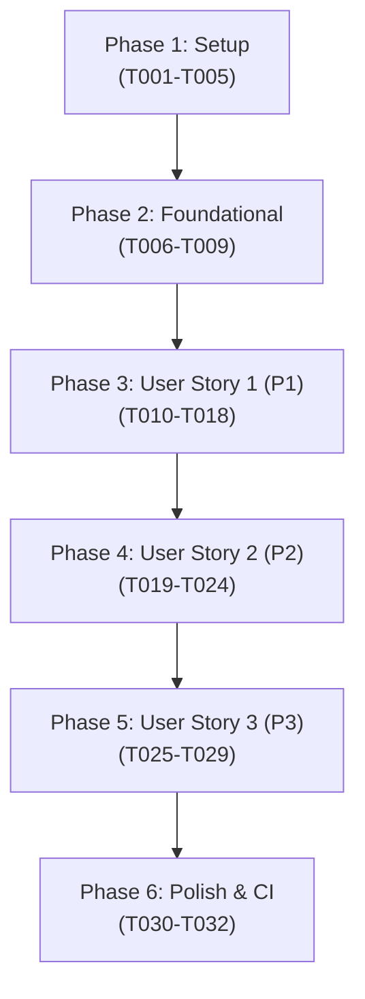

# Tasks: Suíte de Benchmarks TPC-H / TPC-DS (1TB e 10TB) e Whitepaper Científico (FT-101)

**Input**: Documentos de design em `/specs/005-tpch-tpcds-benchmarks/` (`spec.md`, `plan.md`, `research.md`, `data-model.md`, `contracts/tpch_benchmark_api.md`, `quickstart.md`)  
**Prerequisites**: `spec.md`, `plan.md`, `research.md`, `data-model.md`, `contracts/`  
**Constitution**: Ciclo estrito TDD (Red -> Green -> Refactor), cobertura de testes $\ge 95\%$, isolamento estrito de processos e alinhamento de cache de 64 bytes.

---

## Phase 1: Setup (Shared Infrastructure)

**Purpose**: Criação do crate de benchmark `bench/tpch` (`kineplex-bench`), registro no workspace e definição de estruturas compartilhadas.

- [x] T001 Adicionar o crate `bench/tpch` na lista de membros do workspace em `Cargo.toml`
- [x] T002 Criar o manifesto `bench/tpch/Cargo.toml` com dependências para `kineplex-core`, `kineplex-df`, `arrow`, `parquet`, `rayon`, `serde`, `serde_json` e `clap`
- [x] T003 [P] Implementar definições de enums e structs de configuração em `bench/tpch/src/config.rs` (`BenchmarkEngine`, `BenchmarkQueryType`, `BenchmarkRunConfig`)
- [x] T004 [P] Implementar modelos de dados e telemetria em `bench/tpch/src/data_model.rs` (`HardwareTelemetrySnapshot`, `QueryExecutionMetric`, `ComparativeQuerySummary`, `BenchmarkSuiteSummary`)
- [x] T005 Declarar os módulos e re-exportar traits públicas (`TpchQueryExecutor`, `ComparativeBenchmarkRunner`, `WhitepaperPublisher`) em `bench/tpch/src/lib.rs`

---

## Phase 2: Foundational (Blocking Prerequisites)

**Purpose**: Infraestrutura de telemetria Linux `perf_event_open`, monitoramento de memória RSS e gerador de dados particionados via Laguerre CCVT.

**⚠️ CRITICAL**: Pré-requisito bloqueante obrigatório antes da implementação de qualquer User Story.

- [x] T006 [P] Implementar wrapper para a syscall Linux `perf_event_open` para contagem determinística de IPC, misses de cache L1d/LLC e branch misses em `bench/tpch/src/perf_events.rs`
- [x] T007 [P] Implementar coletor estatístico de tempo e medidor de consumo de memória RSS (`/proc/[pid]/status`) em `bench/tpch/src/metrics.rs`
- [x] T008 [P] Implementar o gerador e conversor sintético TPC-H `tpch_datagen` com particionamento de 128 MB de Laguerre CCVT e compressão Smoluchowski em `bench/tpch/src/datagen.rs`
- [x] T009 Criar testes unitários para o gerador de dados e telemetria em `bench/tpch/tests/foundational_tests.rs`

**Checkpoint**: Infraestrutura fundamental validada — início das User Stories desbloqueado.

---

## Phase 3: User Story 1 - Execução Autônoma da Suíte TPC-H e TPC-DS no KinePlex (Priority: P1) 🎯 MVP

**Goal**: Executar as 22 consultas analíticas padrão TPC-H (Q1..Q22) e 6 consultas TPC-DS (DS-Q01, DS-Q03, DS-Q14, DS-Q64, DS-Q72, DS-Q95) no motor KinePlex em escalas 1TB (SF=1000) e 10TB (SF=10000) com Whole-Stage SIMD e CBO Riemanniano.

**Independent Test**: Execução dos testes automatizados de consultas em `kineplex-df/tests/tpch_queries_part1_tests.rs`, `kineplex-df/tests/tpch_queries_part2_tests.rs`, `kineplex-df/tests/tpcds_samples_tests.rs` e do runner nativo `cargo run -p kineplex-bench --bin tpch_runner -- --scale 1`.

### Tests for User Story 1
- [x] T010 [P] [US1] Criar bateria de testes unitários para as consultas TPC-H Q1 a Q11 em `kineplex-df/tests/tpch_queries_part1_tests.rs`
- [x] T011 [P] [US1] Criar bateria de testes unitários para as consultas TPC-H Q12 a Q22 em `kineplex-df/tests/tpch_queries_part2_tests.rs`
- [x] T012 [P] [US1] Criar bateria de testes unitários para as 6 consultas TPC-DS em `kineplex-df/tests/tpcds_samples_tests.rs`

### Implementation for User Story 1
- [x] T013 [US1] Implementar consultas TPC-H Q1 a Q6 na API Catalyst/DataFrame do KinePlex em `bench/tpch/src/queries_tpch_part1.rs` (varreduras SIMD, filtros em $\mathbb{F}_2[x]$ e projeções de data)
- [x] T014 [US1] Implementar consultas TPC-H Q7 a Q14 na API Catalyst/DataFrame do KinePlex em `bench/tpch/src/queries_tpch_part2.rs` (junções multipartes, agregação de lucro e case-when)
- [x] T015 [US1] Implementar consultas TPC-H Q15 a Q22 na API Catalyst/DataFrame do KinePlex em `bench/tpch/src/queries_tpch_part3.rs` (semijunções, anti-joins e contenção de skew por Curvatura de Ollivier-Ricci)
- [x] T016 [US1] Implementar as 6 consultas representativas TPC-DS (DS-Q01, DS-Q03, DS-Q14, DS-Q64, DS-Q72, DS-Q95) em `bench/tpch/src/queries_tpcds.rs`
- [x] T017 [US1] Implementar o executor nativo `KineplexQueryExecutor` com trait `TpchQueryExecutor` em `bench/tpch/src/runner_kineplex.rs`
- [x] T018 [US1] Implementar os binários executáveis CLI `tpch_datagen` em `bench/tpch/src/bin/tpch_datagen.rs` e `tpch_runner` em `bench/tpch/src/bin/tpch_runner.rs`

**Checkpoint**: User Story 1 (MVP) completamente operacional e testável de forma autônoma.

---

## Phase 4: User Story 2 - Harness Comparativo Automatizado com DuckDB e Apache Spark (Priority: P2)

**Goal**: Orquestrar a execução pareada e controlada contra DuckDB e Apache Spark consumindo exatamente os mesmos datasets Parquet/Delta, medindo latência, RSS e speedups relativos.

**Independent Test**: Execução de `cargo test -p kineplex-bench --test comparative_runner_tests` e validação do relatório consolidado em JSON/CSV.

### Tests for User Story 2
- [x] T019 [P] [US2] Criar teste de integração para o runner comparativo em `bench/tpch/tests/comparative_runner_tests.rs`

### Implementation for User Story 2
- [x] T020 [P] [US2] Implementar o runner isolado por subprocesso para DuckDB em `bench/tpch/src/runner_duckdb.rs`
- [x] T021 [P] [US2] Implementar o runner isolado por subprocesso para Apache Spark em `bench/tpch/src/runner_spark.rs`
- [x] T022 [US2] Implementar a engine orquestradora `ComparativeBenchmarkEngine` com trait `ComparativeBenchmarkRunner` em `bench/tpch/src/comparative.rs`
- [x] T023 [US2] Implementar cálculo de médias geométricas (GeoMean), fatores de speedup ($S_{\text{DuckDB}}$, $S_{\text{Spark}}$) e exportação para `reports/tpch_results.json` e `reports/tpch_results.csv` em `bench/tpch/src/export.rs`
- [x] T024 [US2] Implementar o binário executável CLI `comparative_runner` em `bench/tpch/src/bin/comparative_runner.rs`

**Checkpoint**: User Stories 1 e 2 funcionais e integradas sem interferência de processos.

---

## Phase 5: User Story 3 - Publicação do Whitepaper Científico e Relatório Técnico (Priority: P3)

**Goal**: Compilar de forma determinística os resultados empíricos brutos em um Whitepaper científico completo em formato Markdown pronto para submissão e publicação técnica.

**Independent Test**: Execução de `cargo test -p kineplex-bench --test whitepaper_compiler_tests` e inspeção do documento gerado em `docs/whitepaper/kineplex_analytical_superiority.md`.

### Tests for User Story 3
- [x] T025 [P] [US3] Criar teste unitário para o compilador do whitepaper em `bench/tpch/tests/whitepaper_compiler_tests.rs`

### Implementation for User Story 3
- [x] T026 [US3] Implementar o gerador de seções científicas (resumo executivo, fundamentação dos 5 pilares matemáticos, setup de hardware e análise de skew) em `bench/tpch/src/whitepaper_sections.rs`
- [x] T027 [US3] Implementar o compilador `WhitepaperPublisherEngine` com trait `WhitepaperPublisher` gerando tabelas e diagramas em `bench/tpch/src/whitepaper.rs`
- [x] T028 [US3] Implementar o binário executável CLI `generate_whitepaper` em `bench/tpch/src/bin/generate_whitepaper.rs`
- [x] T029 [US3] Gerar e publicar a versão canônica do documento em `docs/whitepaper/kineplex_analytical_superiority.md`

**Checkpoint**: Todas as User Stories (P1, P2, P3) finalizadas com seus artefatos validados.

---

## Phase 6: Polish & Cross-Cutting Concerns

**Purpose**: Validação de ponta a ponta, microarquitetura e garantia de conformidade com os portões de qualidade do workspace.

- [x] T030 [P] Executar o fluxo completo de validação rápida descrito em `specs/005-tpch-tpcds-benchmarks/quickstart.md`
- [x] T031 [P] Atualizar documentação e links técnicos em `docs/` e `README.md`
- [x] T032 Executar `cargo clippy --workspace --all-targets` e `cargo test --workspace` garantindo compilação limpa, zero warnings e cobertura de testes $\ge 95\%$

---

## Dependencies & Execution Order

### Phase Dependencies
- **Setup (Phase 1)**: Sem dependências — execução imediata.
- **Foundational (Phase 2)**: Depende da conclusão de Setup — BLOQUEIA todas as User Stories.
- **User Story 1 (Phase 3)**: Depende da conclusão de Foundational — MVP inicial independente.
- **User Story 2 (Phase 4)**: Depende de User Story 1 (para o runner KinePlex) e Foundational.
- **User Story 3 (Phase 5)**: Depende dos sumários de resultados de User Story 2 / User Story 1.
- **Polish (Phase 6)**: Depende de todas as histórias estarem concluídas.



---

## Parallel Opportunities

```bash
# Execução paralela em Phase 1 (Setup):
Task: "T003 [P] Implementar definições de enums e structs de configuração em bench/tpch/src/config.rs"
Task: "T004 [P] Implementar modelos de dados e telemetria em bench/tpch/src/data_model.rs"

# Execução paralela em Phase 2 (Foundational):
Task: "T006 [P] Implementar wrapper Linux perf_event_open em bench/tpch/src/perf_events.rs"
Task: "T007 [P] Implementar coletor estatístico de tempo e RSS em bench/tpch/src/metrics.rs"
Task: "T008 [P] Implementar gerador sintético tpch_datagen em bench/tpch/src/datagen.rs"

# Execução paralela em Phase 3 (Testes US1):
Task: "T010 [P] [US1] Testes unitários TPC-H Q1..Q11 em kineplex-df/tests/tpch_queries_part1_tests.rs"
Task: "T011 [P] [US1] Testes unitários TPC-H Q12..Q22 em kineplex-df/tests/tpch_queries_part2_tests.rs"
Task: "T012 [P] [US1] Testes unitários TPC-DS em kineplex-df/tests/tpcds_samples_tests.rs"

# Execução paralela em Phase 4 (Runners US2):
Task: "T020 [P] [US2] Implementar runner DuckDB em bench/tpch/src/runner_duckdb.rs"
Task: "T021 [P] [US2] Implementar runner Spark em bench/tpch/src/runner_spark.rs"
```

---

## Implementation Strategy

### MVP First (User Story 1 Only)
1. Completar Setup (T001-T005) e Foundational (T006-T009);
2. Implementar bateria de consultas Q1..Q22 e testes em SF=1 (T010-T018);
3. Validar execução autônoma via `tpch_runner` com zero falhas;
4. **Checkpoint**: MVP entregue e testado independentemente.

### Entrega Incremental
1. MVP (US1): Motor KinePlex executando TPC-H e TPC-DS canônico;
2. Incremento 1 (US2): Harness comparativo com DuckDB e Apache Spark coletando telemetria pareada;
3. Incremento 2 (US3): Compilador e publicação oficial do Whitepaper científico em `docs/whitepaper/`;
4. Polish: Cobertura global $\ge 95\%$ e conformidade integral com a Constituição.
